# Delivery Report: Task Manager

- **Created**: 2026-11-11
- **Scope**: Steps done, cost and time, project structure and architecture, tests and coverage.
- **Screenshots**: Section 9.
- **Evidence rule**: Test and coverage numbers come from runs made on 2026-11-11. Cost and time come from the Forgie session database and `operations/runs/*/events.jsonl`. Section 7 lists the limits.
- **Time zone**: Run times are UTC. Git times are +02:00.
- **Related file**: `docs/project-analysis.md` has the step-by-step story up to 2026-11-03. This report replaces its test counts and cost totals.

## 1. Summary

| Item | Value |
|---|---|
| Product | Task manager: Node.js API, native Android app, native iOS app. |
| Phases done | 1 backend, 2 Android, 3 iOS, plus debt fix TD-001. |
| Phase 4 (hosting, release, cold start) | Partly built. Backend and Android parts are in the working tree, not committed. iOS part not started. Nothing is hosted. |
| Commits | 7 (last: `a2c7904`, 2026-11-03). |
| Tests passing (fresh run) | Backend 61 of 61. Android 49 unit and 16 UI. iOS 37 unit and 8 UI. All pass, 0 fail. |
| Coverage | Backend 90.4 percent lines. iOS app 97.2 percent lines. Android 81 percent instructions from UI tests alone and 26 percent from unit tests alone (not merged). |
| Cost to 2026-11-03 | 75.01 USD (tool estimate) in 439 model calls across 21 sessions. |
| Time | About 3.5 hours of agent work in the main feature run. About 8.1 hours wall time, because of a 4.6 hour wait for the owner. |

Three facts need attention:

1. Earlier docs state 41 Android unit tests, 15 Android UI tests and 11 iOS UI tests. The fresh run gives 49, 16 and 8. Section 5.5 explains.
2. Phase 4 has uncommitted code with no review. Its build step was aborted. Section 2.5 explains.
3. Nothing ran in Docker, in a static scan or on a hosted service.

## 2. Steps completed

### 2.1 Order of work

| # | Step | Date (UTC) | Result | Evidence |
|---|---|---|---|---|
| 0 | User stories, empty Android and iOS projects, agent toolkit | 2026-11-02 | Done | Commits `d222770`, `14ae580`, `8b3218e` |
| 1 | Scope: HLD and four-phase roadmap | 11-02 14:52 | Done | `docs/HLD.md` |
| 2 | Plan: four phase plans | 11-02 14:54 | Done | `operations/archives/.../plan_phase_1..3.md`, `plan_phase_4.md` |
| 3 | Phase 1 build: backend API and database (3 attempts) | 11-02 15:12 | Done on attempt 3 | Section 5.1 |
| 4 | Phase 1 review | 11-02 15:47 | APPROVE with notes | Review step in run events |
| 5 | Phase 2 build and review: Android app | 11-02 15:51 | Done | Section 5.2 |
| 6 | Phase 3 build and review: iOS app | 11-02 16:23 | Done | Section 5.3 |
| 7 | Document: archive plans 1 to 3, ADR-001 to ADR-011, PRD, README | 11-02 22:29 | Done | `operations/archives/2026-11-03-task-manager-phases-1-3/summary.md` |
| 8 | Commit phases 1 to 3 | 11-02 23:00 | Done | `2caef5b`, 106 files, 5,968 lines added |
| 9 | Fix TD-001: pool error listener (plan, build, review, document) | 11-02 23:05 | Done | `a2c7904`, archive `2026-11-03-fix-td-001` |
| 10 | Phase 4 plan, run 1 | 11-03 11:08 | Failed: "The operation was aborted." | Run `implement-...704116653` |
| 11 | Phase 4 plan, run 2 | 11-03 12:54 | Plan done in 26.2 min | `plan_phase_4.md` rewritten (362 lines changed) |
| 12 | Phase 4 build, run 2 | 11-03 13:20 | Aborted after 24.0 min. Partial code kept. | Section 2.5 |
| 13 | Project analysis document | 11-03 12:57 | Done | `docs/project-analysis.md` |
| 14 | This report | 11-11 | Done | This file |

### 2.2 Phase 1: backend

- Built Express 5, zod and `pg` with no ORM (ADR-002).
- Three layers: routes, service, repository (ADR-011 style, `createApp({ pool, clock })`).
- One SQL migration with `node-pg-migrate` (ADR-003).
- Added a Dockerfile. It was never built.
- Three attempts. Attempts 1 and 2 failed because the engine stall limit was 240 seconds. Commit `09c7de9` raised it to 15 minutes.
- Evidence recorded then: build, lint, 55 of 55 tests, migration up, down and up.

### 2.3 Phase 2: Android

- Kotlin, Jetpack Compose, Material 3, Retrofit, OkHttp, kotlinx-serialization.
- One `TaskListViewModel` and manual wiring in `AppContainer` (ADR-011).
- Three library versions were lowered because the planned versions need Kotlin 2.4 (ADR-008).
- Debug builds use HTTP to `10.0.2.2`. Release builds use HTTPS (ADR-009).

### 2.4 Phase 3: iOS

- Swift and SwiftUI. One `TaskListViewModel`. A `MockTaskAPI` for UI tests.
- The base URL comes from `ios/Config/Info-Debug.plist` and `Info-Release.plist` (ADR-009).
- The build step blocked at 17:27 UTC (no sign of life for 1,126 s). The owner answered "continue" at 22:04 UTC.

### 2.5 Phase 4: state now

Phase 4 adds hosting on Render and Neon, and cold start handling in both apps. The working tree has 25 changed files that are not committed.

| Plan task | Part | State | Evidence |
|---|---|---|---|
| TASK-P4-001 | Pool connect timeout (10 s) | Done, uncommitted | `backend/src/db.ts` diff. `db.test.ts` has 4 tests. |
| TASK-P4-002 | `GET /health/live` without database access | Done, uncommitted | `backend/src/health/health.routes.ts`. `health.api.test.ts` has 5 tests. |
| TASK-P4-003 | Dockerfile `exec` | Done, uncommitted. Image not built. | `backend/Dockerfile` diff |
| TASK-P4-010 | Android data layer: `ApiError.Unavailable`, 90 s read timeout | Done, uncommitted | `ApiTaskRepository.kt`, `AppContainer.kt` |
| TASK-P4-011 | Android view model: waking hint, retry for about 90 s | Done, uncommitted | `TaskListViewModel.kt`. Tests added in `TaskListViewModelTest.kt`. |
| TASK-P4-012, 013 | iOS data layer and view model | Not started | `git diff --stat -- ios` is empty |
| TASK-P4-004 to 009 | Neon, repo access, `render.yaml`, hosted smoke test, cold start measure | Not started. Need the owner. | No `render.yaml` in the repo |
| TASK-P4-015 to 019 | Hosted URL, release builds, cross-device check, docs, fresh clone | Not started | Release URL is still `https://example.invalid/` |

No review ran on this code. The Phase 4 build step was aborted, so the agent never reached a review.

## 3. Cost and time

### 3.1 Totals

| Measure | Value |
|---|---|
| Model calls | 439 |
| Sessions | 21 |
| Input tokens | 34,388,005 |
| Output tokens | 613,082 |
| Cached read tokens | 489,126 (orchestrator model only) |
| Cost | 75.01 USD |
| Later report sessions (2026-11-11, this task) | 20 calls, 2.62 USD. Not in the 75.01 total. |

Input is 98.2 percent of all tokens. The Sonnet model reports no cached tokens. See `docs/project-analysis.md` section 7.

### 3.2 Cost and time per step

Times come from run events. "Active" is the length of the step. Cost comes from the `cost` field of each model message.

| Step | Calls | Input tokens | Output tokens | Cost (USD) | Active time |
|---|---|---|---|---|---|
| Orchestrator sessions (3, incl. rewinds) | 49 | 920,017 | 5,646 | 2.00 | n/a |
| Scope | 7 | 323,936 | 11,084 | 0.76 | 1.9 min |
| Plan phases 1 to 4 | 34 | 3,543,536 | 96,008 | 8.05 | 18.1 min |
| Build phase 1 (3 attempts) | 30 | 2,020,559 | 30,527 | 4.35 | 21.5 min (8.0 + 10.0 + 3.5) |
| Review phase 1 | 9 | 434,053 | 14,645 | 1.01 | 3.8 min |
| Build phase 2 Android | 70 | 8,523,383 | 80,168 | 17.85 | 29.2 min |
| Review phase 2 | 9 | 480,394 | 9,484 | 1.06 | 2.5 min |
| Build phase 3 iOS | 55 | 5,915,131 | 49,797 | 12.33 | 64.6 min before the block, 21.4 min after the resume |
| Review phase 3 | 12 | 703,379 | 11,853 | 1.53 | 2.9 min |
| Document (archive, ADRs, PRD, README) | 27 | 2,210,792 | 37,059 | 4.79 | 28.4 min |
| TD-001 (5 sessions) | 30 | 1,171,667 | 16,788 | 2.51 | 4.5 min (1.2 canceled run + 3.3 completed run) |
| Phase 4 plan, run 1 (aborted) | 22 | 1,637,853 | 53,283 | 3.81 | 28.0 min |
| Phase 4 plan, run 2 | 28 | 2,993,292 | 139,587 | 7.38 | 26.2 min |
| Phase 4 build, run 2 (aborted) | 23 | 1,572,207 | 23,829 | 3.38 | 24.0 min |
| Documentation refresh (`project-analysis.md`) | 34 | 1,937,806 | 33,324 | 4.21 | 10.6 min |
| **Total** | **439** | **34,388,005** | **613,082** | **75.01** | |

The rounded cost column adds up to 75.02 USD. The database total is 75.01 USD. The 0.01 difference is rounding.

### 3.3 Cost by group

| Group | Cost (USD) | Share |
|---|---|---|
| Main feature run (scope to document) | 51.73 | 69.0 percent |
| Phase 4 (plan 1, plan 2, build) | 14.57 | 19.4 percent |
| Documentation refresh | 4.21 | 5.6 percent |
| TD-001 fix | 2.51 | 3.3 percent |
| Orchestrator sessions | 2.00 | 2.7 percent |

### 3.4 Cost by phase of product

| Product part | Cost (USD) | Notes |
|---|---|---|
| Backend (build 4.35 + review 1.01) | 5.36 | Includes 1.97 USD for two failed attempts. |
| Android (build 17.85 + review 1.06) | 18.91 | Largest item. |
| iOS (build 12.33 + review 1.53) | 13.86 | |
| Planning and scoping | 8.81 | Scope 0.76 and plan 8.05. |
| Documentation | 4.79 | |

### 3.5 Time

| Measure | Value |
|---|---|
| First commit to last commit | 2026-11-02 15:54 to 2026-11-03 01:20 (+02:00). About 9.4 hours. |
| Main feature run, wall time | 8 h 04 min (14:52 to 22:57 UTC) |
| Wait for owner (iOS block) | 4 h 37 min (17:27 to 22:04 UTC). No tokens used. The old analysis says 4.6 hours. |
| Main feature run, agent time | About 3 h 28 min (wall time minus the wait) |
| Time lost to failed or aborted runs | About 18 min (phase 1 attempts 1 and 2), 28 min (phase 4 plan run 1), 24 min (phase 4 build) |
| TD-001 fix, end to end | 4.5 min of agent time |

### 3.6 Where the money went

1. Builders cost the most. Android and iOS builds are 30.18 USD, 40 percent of the total.
2. Planning cost 8.05 USD for the first plan. Phase 4 planning cost 11.19 USD across two runs. That is more than the first plan for all four phases (8.05 USD).
3. Reviews are cheap: 4.00 USD for four reviews, with 0 critical and 0 high findings.
4. Cost lost to aborted or canceled runs: 1.97 (phase 1 attempts) + 3.81 (phase 4 plan 1) + 0.22 (canceled TD-001 plan) = 6.00 USD. The aborted phase 4 build (3.38 USD) kept partial code, so it is not a full loss.

## 4. Project structure and architecture

### 4.1 System

```
 ┌──────────────┐        ┌──────────────┐
 │ Android app  │        │   iOS app    │
 │ Kotlin       │        │ Swift        │
 │ Compose      │        │ SwiftUI      │
 └──────┬───────┘        └──────┬───────┘
        │   REST / JSON over HTTP (debug) or HTTPS (release)
        └───────────────┬───────┘
                        ▼
              ┌───────────────────┐
              │ Backend API       │
              │ Node 22, Express 5│
              │ zod, pino, helmet │
              └─────────┬─────────┘
                        │ pg (bind parameters, no ORM)
                        ▼
              ┌───────────────────┐
              │ PostgreSQL 17     │
              │ table: tasks      │
              └───────────────────┘
```

The server owns `overdue` and the summary counts (ADR-004). The apps do not repeat these rules. Dates are `YYYY-MM-DD` strings end to end (ADR-010). There is no authentication (ADR-007).

### 4.2 Repository layout

```
task-manager-demo/
├── backend/        Node.js + TypeScript API
├── android/        Kotlin + Jetpack Compose app
├── ios/            Swift + SwiftUI app
├── docs/           HLD, PRD, ADR-001..011, technical debt, user stories, reports
├── operations/     specs (open plans), archives (done plans), runs (workflow events)
├── DESIGN.md       UI rules
└── AGENTS.md       Project rules for agents
```

### 4.3 Backend

```
backend/
├── Dockerfile
├── migrations/1730500000000_create-tasks.sql
├── src/
│   ├── server.ts            Start-up: read config, create pool, listen
│   ├── app.ts               createApp({ pool, clock }): middleware and routers
│   ├── config.ts            Environment variables
│   ├── db.ts                createPool: DATE as string, 10 s connect timeout, error listener
│   ├── logger.ts            pino
│   ├── errors.ts            AppError
│   ├── errorHandler.ts      Error and not-found handlers
│   ├── health/health.routes.ts     GET /health, GET /health/live
│   ├── summary/summary.routes.ts   GET /api/summary
│   └── tasks/
│       ├── task.routes.ts          HTTP layer
│       ├── task.schemas.ts         zod input rules
│       ├── task.service.ts         Business rules (overdue, summary)
│       └── task.repository.ts      SQL
└── test/  7 test files and 3 helpers
```

| Item | Detail |
|---|---|
| Pattern | Layered: routes (HTTP and zod), service (rules), repository (SQL). |
| Dependency passing | `createApp({ pool, clock })`. Tests pass a test pool and a fixed clock. |
| Endpoints | `POST /api/tasks`, `GET /api/tasks`, `PATCH /api/tasks/:id`, `DELETE /api/tasks/:id`, `GET /api/summary`, `GET /health`, `GET /health/live` |
| Security | helmet, 16 KB body limit, `x-powered-by` off, bind parameters, malformed ID returns 404, request log has no body. |
| Data | Table `tasks`: `id` UUID, `title` (1 to 100), `description` nullable, `priority` LOW/MEDIUM/HIGH, `status` TODO/IN_PROGRESS/DONE, `due_date` DATE, `created_at`, `updated_at`. Index on `(status, priority)`. |
| Size | 545 lines in `src`, 515 lines in `test`. |

### 4.4 Android

```
android/app/src/
├── main/java/com/demo/taskmanager/
│   ├── MainActivity.kt
│   ├── AppContainer.kt          Manual wiring. Only reader of BuildConfig.
│   ├── data/
│   │   ├── Task.kt              Models, Priority, Status, TaskDraft, TaskFilters
│   │   ├── TaskApi.kt           Retrofit interface and DTOs
│   │   ├── TaskRepository.kt    Interface and ApiError
│   │   └── ApiTaskRepository.kt Maps DTOs and errors
│   └── ui/
│       ├── TaskApp.kt           Root composable
│       ├── TaskListViewModel.kt One view model, StateFlow<UiState>
│       ├── UiState.kt           UiState, FormState, Phase, UiMessage
│       ├── TaskListScreen.kt, TaskFormScreen.kt, TaskRow.kt
│       ├── SummaryPanel.kt, FilterChips.kt, DeleteDialog.kt
│       ├── DateConversion.kt
│       └── theme/ Color.kt, Spacing.kt, Theme.kt, Type.kt
├── debug/res/xml/network_security_config.xml     HTTP allowed
├── release/res/xml/network_security_config.xml   HTTPS only
├── sharedTest/.../FakeTaskRepository.kt          Shared by unit and UI tests
├── test/        3 unit test files
└── androidTest/ 1 UI test file (Compose)
```

| Item | Detail |
|---|---|
| Pattern | Single-activity Compose app. Unidirectional data flow: UI sends actions to `TaskListViewModel`, the view model exposes `StateFlow<UiState>`. |
| Wiring | Manual, no DI framework (ADR-011). |
| Config | `minSdk` 26, `targetSdk` 36. Debug `API_BASE_URL` is `http://10.0.2.2:3000/`. Release is a placeholder. |
| Cold start (uncommitted) | Waking hint after 4 s. Retry on `Unavailable` every 5 s, up to 18 times. 90 s read timeout. |
| Size | 1,661 lines in `main`, 962 lines in tests. |

### 4.5 iOS

```
ios/
├── Config/Info-Debug.plist, Info-Release.plist    API_BASE_URL per build type
├── TaskManager/
│   ├── TaskManagerApp.swift
│   ├── AppEnvironment.swift        Picks real or mock API at launch
│   ├── Data/
│   │   ├── TaskAPI.swift           Protocol and APIError
│   │   ├── URLSessionTaskAPI.swift Real API
│   │   ├── MockTaskAPI.swift       Used by UI tests (-UITestMock)
│   │   └── TaskModels.swift
│   └── Features/
│       ├── TaskListViewModel.swift One view model
│       ├── TaskListView.swift, TaskFormView.swift, TaskRowView.swift
│       ├── SummaryPanelView.swift, FilterChipsView.swift, ToastView.swift
│       ├── DateConversion.swift, Theme.swift
├── TaskManagerTests/        3 unit test files
├── TaskManagerUITests/      2 UI test files
└── TaskManager.xcodeproj    Scheme TaskManager
```

| Item | Detail |
|---|---|
| Pattern | SwiftUI with one observable view model. The `TaskAPI` protocol is the seam. Tests use `MockTaskAPI`. |
| Config | Base URL from the Info plist. A missing or invalid URL gives no API. |
| Size | 1,211 lines in the app, 613 lines in tests. |

### 4.6 Same design on both apps

| Concern | Android | iOS |
|---|---|---|
| API seam | `TaskRepository` interface | `TaskAPI` protocol |
| State holder | `TaskListViewModel` | `TaskListViewModel` |
| Test double | `FakeTaskRepository` | `MockTaskAPI` |
| Base URL source | `BuildConfig.API_BASE_URL` | Info plist `API_BASE_URL` |
| Plain HTTP | Debug only | Debug only |

## 5. Tests and coverage

All numbers below come from runs on 2026-11-11.

### 5.1 Summary

| Part | Unit or API tests | UI tests | Total | Failed | Command |
|---|---|---|---|---|---|
| Backend | 61 | n/a | 61 | 0 | `npm test` |
| Android | 49 | 16 | 65 | 0 | `./gradlew test`, `connectedDebugAndroidTest` |
| iOS | 37 | 8 | 45 | 0 | `xcodebuild test` (iPhone 17 Pro simulator) |
| **Total** | **147** | **24** | **171** | **0** | |

Backend `npm run build` and `npm run lint` also passed with no output (0 errors, 0 warnings).

### 5.2 Backend tests

Real PostgreSQL database `taskmanager_test`. The setup refuses a database name that does not end in `_test`.

| File | Tests | What it covers |
|---|---|---|
| `tasks.api.test.ts` | 22 | Create, list, filter, update, status change, delete, validation, not found |
| `task.schemas.test.ts` | 14 | zod rules: title trim and length, date, enums, strict objects |
| `task.service.test.ts` | 9 | Overdue rule, summary counts, fixed clock |
| `health.api.test.ts` | 5 | `/health`, `/health/live`, 503 on database error |
| `config.test.ts` | 4 | Environment parsing |
| `db.test.ts` | 4 | Pool error listener, connect timeout, no URL in the log |
| `summary.api.test.ts` | 3 | Summary endpoint |
| **Total** | **61** | |

### 5.3 Backend coverage (v8, `src/**`)

| Metric | Value |
|---|---|
| Statements | 88.72 percent |
| Branches | 90.00 percent |
| Functions | 84.21 percent |
| Lines | 90.37 percent |

| File | Lines | Note |
|---|---|---|
| `app.ts`, `config.ts`, `db.ts`, `errorHandler.ts`, `errors.ts`, `logger.ts` | 100 | `logger.ts` branch 50 percent |
| `health.routes.ts`, `summary.routes.ts`, `task.routes.ts`, `task.schemas.ts` | 100 | |
| `task.repository.ts` | 100 | Branch 81.25 percent, lines 89 to 113 |
| `task.service.ts` | 100 | Branch 95.65 percent, line 52 |
| `server.ts` | 0 | Start-up file. No test starts the server. |

I used `@vitest/coverage-v8@5.0.5` installed with `--no-save`. `package.json` and the lock file did not change. The repo has no coverage script or threshold.

### 5.4 Android tests

| Level | File | Tests |
|---|---|---|
| Unit | `TaskListViewModelTest.kt` | 29 |
| Unit | `ApiTaskRepositoryTest.kt` (MockWebServer) | 17 |
| Unit | `DateConversionTest.kt` | 3 |
| UI (Compose, Pixel_8 emulator) | `TaskAppTest.kt` | 16 |
| **Total** | | **65** |

Unit tests use `FakeTaskRepository` or MockWebServer, never the real network.

### 5.5 Android coverage (JaCoCo)

The two runs give two reports. I did not merge them. The union is at least the higher value in each row.

| Package | Unit tests only (instructions) | UI tests only (instructions) |
|---|---|---|
| `data` | 86 percent | 26 percent |
| `ui` | 21 percent | 89 percent |
| `ui.theme` | 0 percent | 95 percent |
| root (`AppContainer`, `MainActivity`) | 0 percent | 0 percent |
| **All** | **26 percent** (2,503 of 9,313) | **81 percent** (7,547 of 9,313) |

Branches: 28 percent (unit) and 67 percent (UI). Lines: 28 percent (unit) and 83 percent (UI).

Key points:

1. The data layer and the view model are covered by unit tests (`TaskListViewModel` 91 percent, `ApiTaskRepository` 93 percent).
2. The screens are covered only by UI tests.
3. `AppContainer.kt` and `MainActivity.kt` have 0 percent in both runs. The UI tests inject a fake repository, so the real wiring never runs in a test.
4. The coverage setup is a temporary Gradle init script outside the repo. The repo has no coverage plugin.

### 5.6 iOS tests

| Level | File | Tests |
|---|---|---|
| Unit | `TaskListViewModelTests.swift` | 19 |
| Unit | `URLSessionTaskAPITests.swift` | 14 |
| Unit | `TaskManagerTests.swift` | 4 |
| UI | `TaskManagerUITests.swift` | 7 |
| UI | `TaskManagerUITestsLaunchTests.swift` | 1 |
| **Total** | | **45** |

The test session took about 150 seconds. Xcode 26.6.

### 5.7 iOS coverage (Xcode, unit and UI tests together)

| Target | Line coverage |
|---|---|
| `TaskManager.app` | **97.24 percent** (1,408 of 1,448) |
| `TaskManagerTests.xctest` | 97.58 percent |
| `TaskManagerUITests.xctest` | 98.74 percent |

| App file | Coverage |
|---|---|
| `Theme`, `TaskRowView`, `AppEnvironment`, `TaskModels`, `ToastView`, `SummaryPanelView`, `DateConversion`, `MockTaskAPI` | 100 percent |
| `TaskListView` | 98.48 percent |
| `FilterChipsView` | 98.11 percent |
| `TaskFormView` | 96.52 percent |
| `TaskListViewModel` | 93.81 percent |
| `URLSessionTaskAPI` | 92.41 percent |
| `TaskManagerApp` | 87.10 percent |

### 5.8 Differences from earlier documents

| Claim in earlier docs | Fresh result | Reason |
|---|---|---|
| Backend 58 tests | 61 | Likely the Phase 4 tests. The diff adds lines to `health.api.test.ts` and `db.test.ts`. I did not map each new test. |
| Android 41 unit tests | 49 | Likely the Phase 4 tests. The diff adds 73 lines to `TaskListViewModelTest.kt`. I did not map each new test. |
| Android 15 UI tests | 16 | Likely the Phase 4 change. The diff adds 14 lines to `TaskAppTest.kt`. |
| iOS 11 UI tests | 8 | The file has 7 tests plus 1 launch test. I cannot find the source of "11". |

Files to correct: `operations/archives/2026-11-03-task-manager-phases-1-3/summary.md` and `docs/project-analysis.md`.

### 5.9 Not run

| Check | State |
|---|---|
| Docker build of `backend/Dockerfile` | Not run (TD-002) |
| Static security scan | Not run (TD-005) |
| Hosted run on Render and Neon | Not run. No `render.yaml` exists. |
| Android `lint` and release build | Not re-run in this report |
| iOS Debug and Release build with the plain build command | Not re-run. The test run builds Debug. |
| Cross-device check (Android and iOS on one backend) | Not run |
| Performance, load, accessibility audit | Not run |

## 6. Findings and next steps

| ID | Finding | Severity | Next step |
|---|---|---|---|
| R-1 | Phase 4 code is uncommitted and not reviewed. | Medium | Run a review of the 25 changed files. Commit after the owner agrees. |
| R-2 | Phase 4 iOS tasks (012, 013) are missing. The iOS app has no cold start handling. | Medium | Build them, with tests, before the hosted check. |
| R-3 | Test counts in two docs are stale (section 5.8). | Low | Update both files. |
| R-4 | Android real wiring (`AppContainer`) has no test. | Low | Add a test that builds `AppContainer` with a MockWebServer URL. |
| R-5 | Android unit coverage is 26 percent, and the UI layer depends on emulator tests. | Low | Add a JaCoCo task to the repo if the owner wants a gate. |
| R-6 | `server.ts` has 0 percent coverage. | Low | Accept, or add a start-up smoke test. |
| R-7 | Aborted runs cost 6.00 USD with no kept result. | Medium | Keep the 15 minute stall limit. Split the Phase 4 build into smaller steps. |
| R-8 | Sonnet calls use no prompt cache. Input is 98 percent of tokens. | Medium | Test prompt caching on one builder step. |
| R-9 | Phase 4 needs the owner for Neon, Render, `git push` and the iOS signing team. | High | Owner action. |
| R-10 | Android has no pull to refresh. A change made on iOS does not show on Android until a local action or a restart (section 9.3, steps 4 and 5). The cross-device check TASK-P4-017 expects "refresh iOS" and "create on Android". | Medium | Decide whether Android needs pull to refresh. Add it before TASK-P4-017 if yes. |

## 7. Limits of the data

1. **Cost is a tool estimate.** The `cost` field uses the tool price table. It is not an invoice.
2. **Failed attempt cost is a time-window estimate.** Phase 1 attempts 1 and 2 share one session with attempt 3.
3. **No data exists for the three setup commits** made before 2026-11-02 14:52 UTC.
4. **Time for build 3 (iOS) is split.** The model may have been idle for part of the 64.6 minutes before the block. I report the event times only.
5. **Android coverage reports are not merged.** The numbers in section 5.5 are two views.
6. **Coverage numbers use my own tool settings.** The repo has no coverage gate. Another tool or filter gives other values.
7. **Group costs in section 3.3 use rounded step costs.** They can differ from the database by 0.01 USD.
8. **The 25 changed files are a snapshot** of the working tree on 2026-11-11.

## 8. How to repeat the numbers

| Item | Command |
|---|---|
| Backend tests | In `backend/`: `npm run build && npm run lint && npm test` |
| Backend coverage | `npm install --no-save @vitest/coverage-v8@5.0.5`, then `npx vitest run --coverage --coverage.include='src/**'` |
| Android unit tests | In `android/`, with `JAVA_HOME` set: `./gradlew test` |
| Android UI tests | Start the emulator, then `./gradlew connectedDebugAndroidTest` |
| Android coverage | Add an init script that sets `enableUnitTestCoverage` and `enableAndroidTestCoverage` on the debug build type. Run `./gradlew -I <script> createDebugCoverageReport`. |
| iOS tests and coverage | In `ios/`: `xcodebuild test -scheme TaskManager -destination 'platform=iOS Simulator,name=iPhone 17 Pro' -parallel-testing-enabled NO -enableCodeCoverage YES -resultBundlePath <path>`, then `xcrun xccov view --report <path>` |
| Cost and tokens | `sqlite3 -readonly` on the Forgie database. Sum `tokens.input`, `tokens.output` and `cost` of assistant messages per session. |
| Step times | Read `operations/runs/*/events.jsonl`. |

## 9. Screenshots

Images are in `docs/images/`. Section 9.1 has the app on both platforms with sample data. Section 9.2 has one walkthrough of the same flow on both platforms.

### 9.1 List screen with sample data

Backend: local dev server on `localhost:3000`. Data: 6 tasks, 1 overdue. Date of capture: 2026-11-11.

| Android (Pixel 8 emulator) | iOS (iPhone 17 simulator) |
|---|---|
| 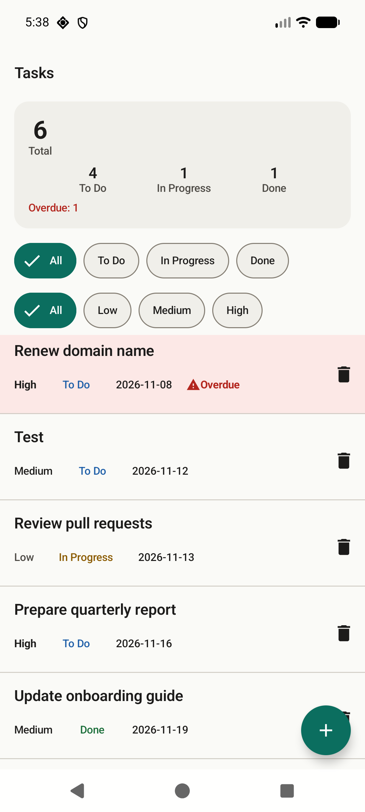 | 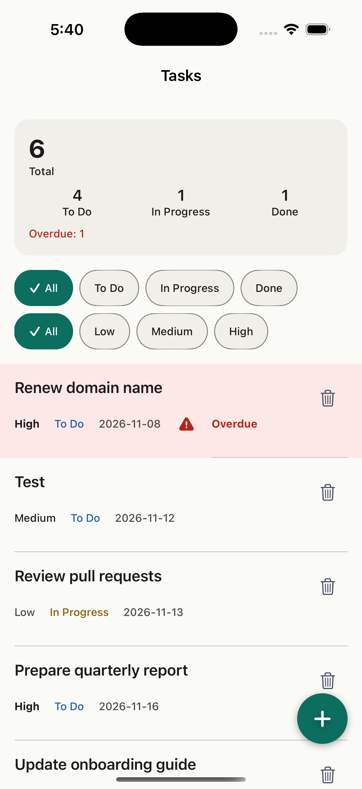 |

The summary panel, the two filter rows and the overdue row (red background, "Overdue" label) look the same on both platforms. The overdue state is computed by the server (ADR-004).

### 9.2 Android filter and create form

| Filter "In Progress" (Android) | New task form (Android) |
|---|---|
| 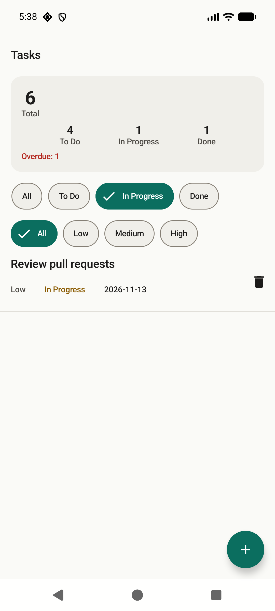 | 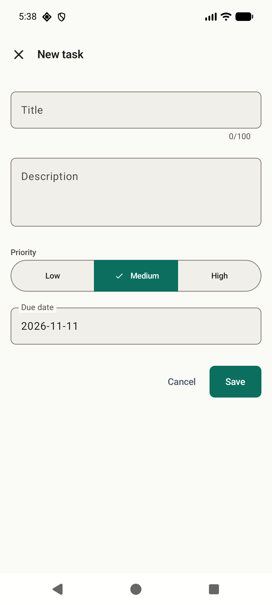 |

The status filter shows one task. The summary still counts all 6 tasks, because the server computes the counts for all tasks, not for the filter.

### 9.3 Side by side walkthrough (iOS left, Android right)

Backend: local dev server. Source: screen captures taken by the owner on 2026-11-11, 17:29 to 17:30.

| Step | Screenshot |
|---|---|
| 1. Empty state: "No tasks yet. Tap + to add one." | 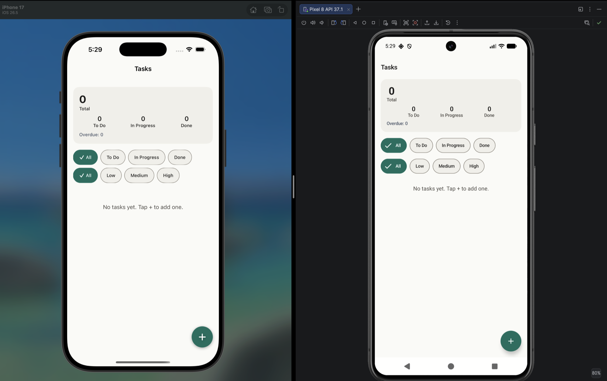 |
| 2. New task form: title, description, priority, due date | 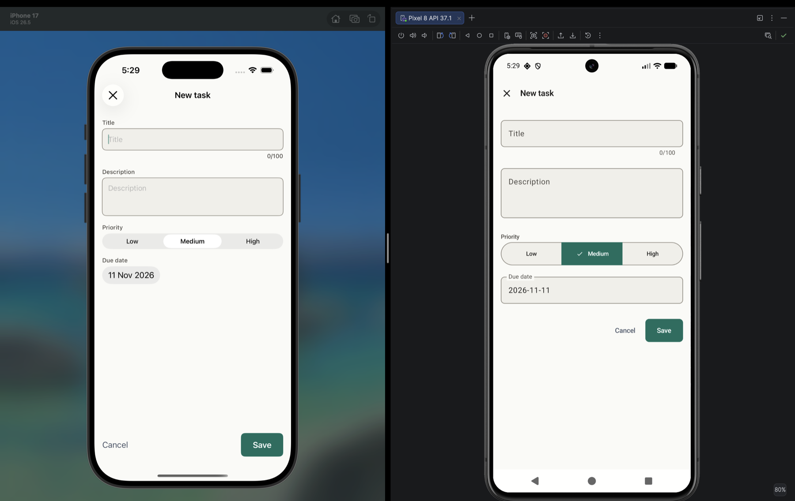 |
| 3. Native date picker. Past days are disabled. | 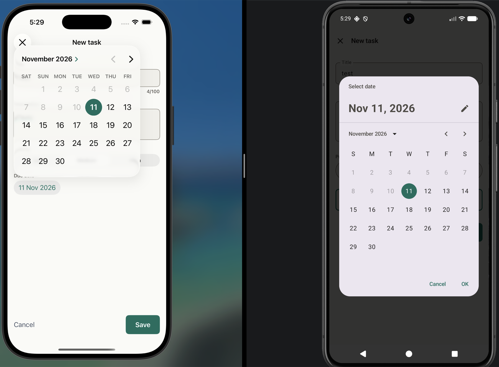 |
| 4. Task created. Toast "Task created". | 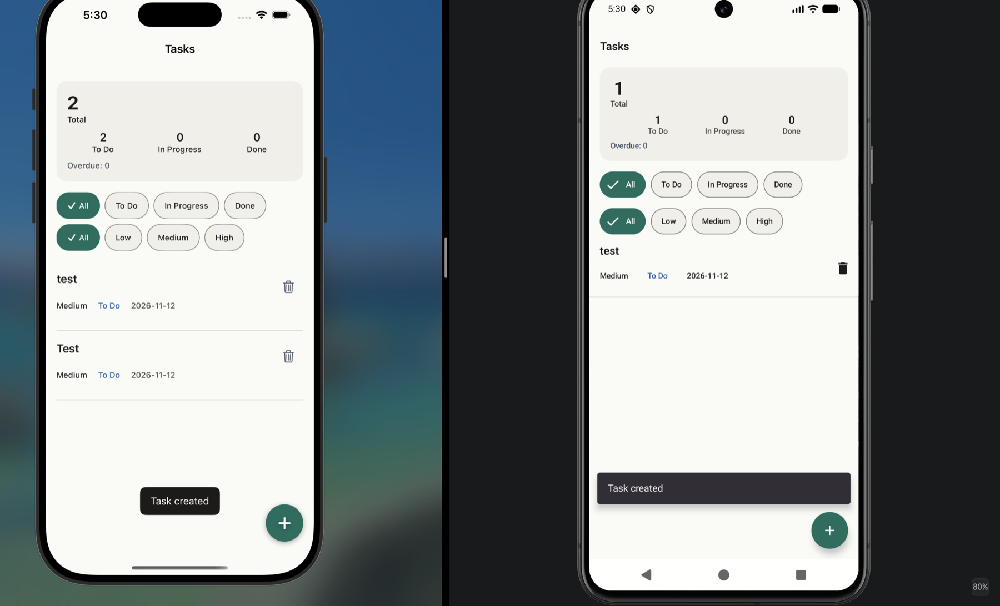 |
| 5. List after creation | 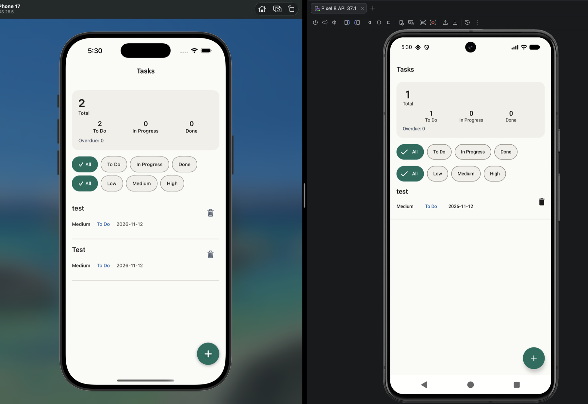 |
| 6. Delete confirmation: "This cannot be undone." | 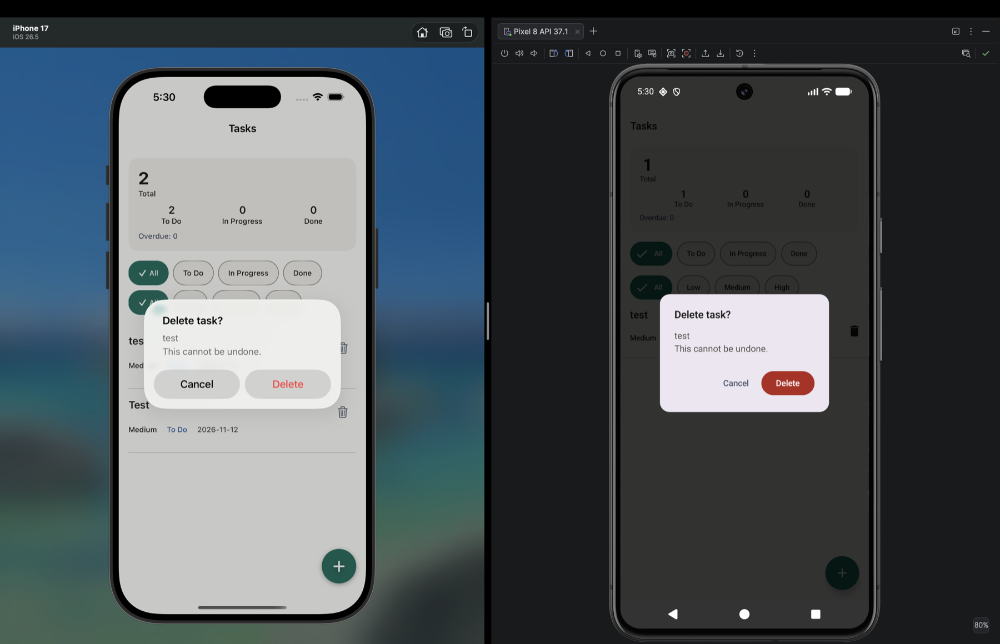 |
| 7. After delete | 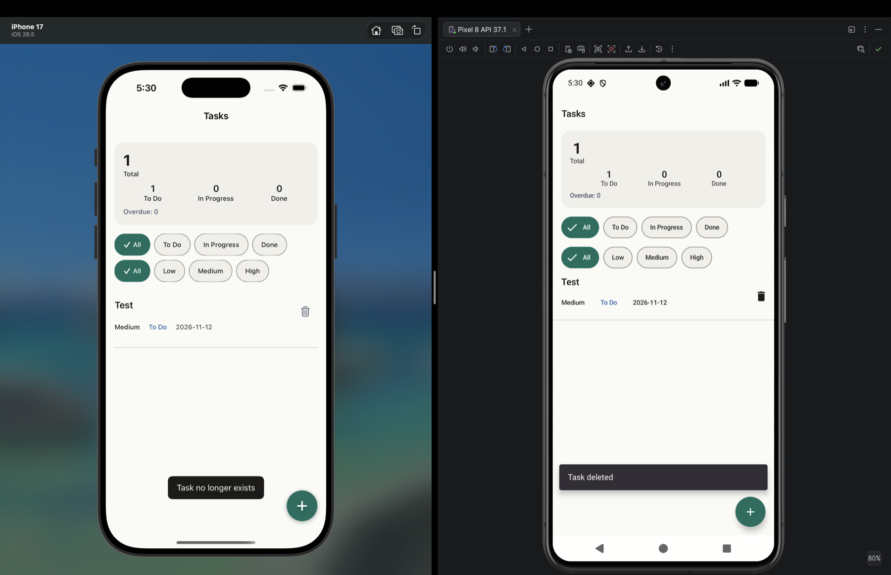 |

Notes on steps 4 to 7:

1. Both apps share one backend. In step 4 the iOS app shows 2 tasks and the Android app shows 1. Step 5 still shows this gap. The iOS app has pull to refresh (`.refreshable` in `TaskListView.swift`). The Android app has no pull to refresh. It reloads only after its own changes, so it shows another device's change only after a restart or a local action. I found no user story that requires pull to refresh. Section 6 lists this as R-10.
2. In step 6 both apps ask to delete the same task "test". In step 7 the Android app shows "Task deleted" and the iOS app shows "Task no longer exists". This fits one app deleting the task first and the other getting a 404. I did not see the order of the taps. The result shows the not-found message works across two devices.
3. The remaining task "Test" was created at 17:30 during the captures. It is the only task left in the dev database. I did not delete it.

### 9.4 Limits

1. Screenshots show Debug builds on a simulator and an emulator, not a physical device.
2. The emulator window in section 9.3 is the Pixel 8 AVD from Android Studio. Its title bar reads "Pixel 8 API 37.1".
3. The data in 9.1 and 9.2 is sample data that I added. I removed it after the capture. The task "Test" belongs to the owner and stays.
4. No dark mode, tablet or landscape screenshots exist.
5. No iOS screenshot shows a filter. The iOS form appears only in the side-by-side image (step 2). I could not drive the iOS simulator from the terminal, and the owner's captures do not include a filter.
